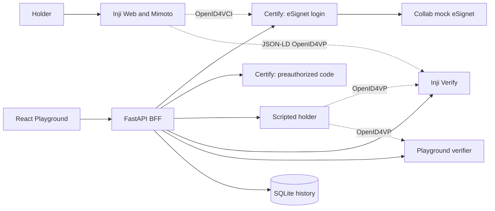
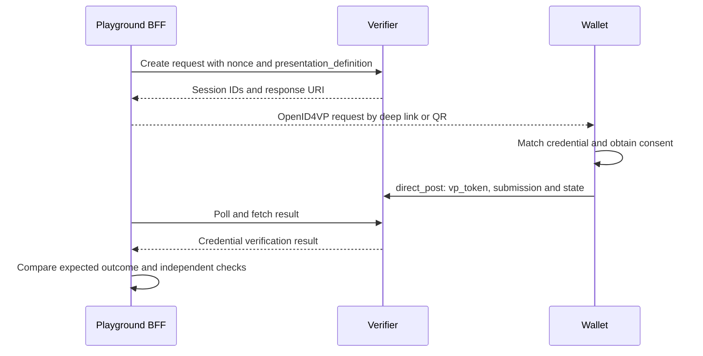

# Playground architecture

Architecture reference: commit `96d38b0892f07f9b0e972123f166476e79ec5c3f`.

## Components

| Component | Implementation | Responsibility |
|---|---|---|
| Frontend | React, TypeScript, Vite, Tailwind | Select participants/format/scenario; display inspector, sequence diagram and reports |
| BFF | Python/FastAPI | Orchestrate flows, expose the UI API, save history and produce reports |
| Issuer | Inji Certify 0.14.0 | Issue JSON-LD, SD-JWT and mock mDoc credentials |
| Real wallet | Inji Web 0.17.0 + Mimoto 0.22.0 | Download/store credentials and obtain consent for supported presentations |
| Scripted holder | `verify/scripts/wallet.py` | Retain the holder key and exercise positive/negative protocol cases |
| Verifiers | Inji Verify 0.18.2 and Playground verifier | Return results, compared with independent checks |
| Storage | SQLite in ignored `playground/.data/` | Keep runs, captured steps, timings and module versions |

The baseline proposed Node/Express. The actual BFF uses Python/FastAPI and reuses the issuer/presentation scripts; its independent verifier contains validation logic as well as orchestration.

## Issuance and presentation

Two local Certify instances share a database and signing keystore. One uses authorization code/PKCE through Collab mock eSignet; the other creates a preauthorized offer with the mock subject. The scripted holder retains its own key for presentation proof. The eSignet-path offer displayed for the scripted flow is constructed by the Playground; the preauthorized offer comes from Certify.

Inji Web downloads through Mimoto after sign-in. The BFF guides the user and waits for confirmation; it does not capture Mimoto's internal token/credential exchanges.

Scripted flows expose their requests/responses. Real-wallet flows expose relying-party requests and verifier results, but not the full submitted VP; independent holder/nonce checks can therefore be unavailable. The submission must state this limitation.

A credential result and test verdict are different: a tampered credential correctly returning `INVALID` passes the test. Acceptance as `VALID` creates a failed test/finding. Errors and unsupported paths are recorded separately.

## Deployment and limits

`python integration/stack.py up` starts Docker services, HTTPS tunnels and the Playground. Setup requires Google OAuth configuration and the team's shared issuer keystore/seed. Replacing the published DID with a different instance's keys would affect teammates.

The pinned real wallet receives JSON-LD and SD-JWT but presents only JSON-LD. The scripted holder supports both end-to-end. mDoc issuance exists; mDoc OpenID4VP presentation is unsupported. The Digital Credentials API needs a supporting browser, wallet and already-held credential for live acceptance.

The Playground verifier has an unresolved SD-JWT validation limit: when the claimed issuer's key endpoint is unavailable, the issuer-key binding check returns unknown and the verifier can still accept a credential signed with an unrelated key. A valid signature against the credential's own self-signed certificate does not establish issuer ownership. The [local verification results](interoperability-report.md#local-verification--2026-10-25) reproduce this condition; successful offline scenarios do not establish safe behavior when issuer metadata is unavailable.

See [API documentation](API_DOCUMENTATION.md), [evidence](interoperability-report.md) and [submission checklist](submission-checklist.md).
